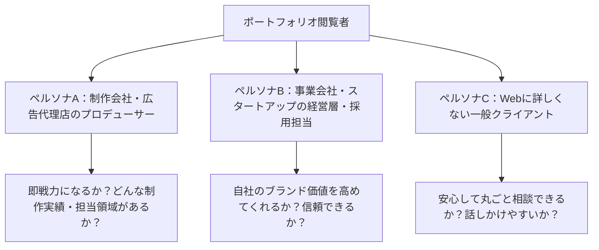
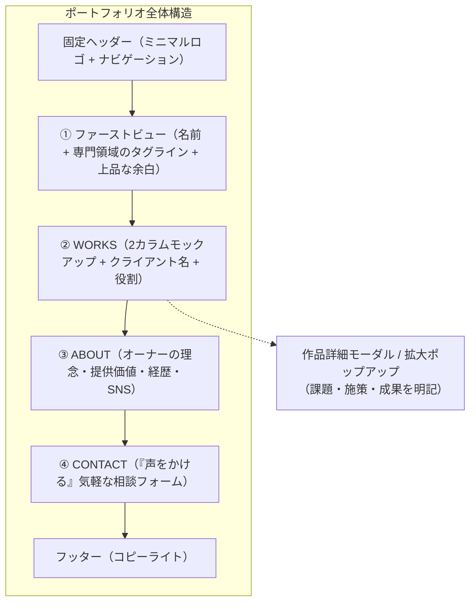

# 【マーケティング・UI/UXリサーチレポート】見やすさ重視のポートフォリオサイト徹底研究

**作成日**: 2026年11月10日  
**作成者**: AI-company マーケティング・リサーチ担当  
**対象**: オーナー（社長）および統括ディレクター  
**参考対象**: [佐藤タカアキ氏 ポートフォリオサイト（https://sato-takaaki.work/）] および提供ビジュアル資料  

---

## エグゼクティブ・サマリー（要約）

本調査では、オーナー（社長）からの「見やすさ重視のポートフォリオを作りたい」というご要望を受け、業界内でも「圧倒的に見やすく洗練されている」と評価の高いデザイナー・佐藤タカアキ氏のポートフォリオサイトを徹底的にリバースエンジニアリング（構造分解・分析）いたしました。

分析の結果、このサイトが見やすい理由は単に「シンプルでおしゃれ」だからではなく、**「閲覧者の脳にかかる負担（認知負荷）を極限まで削ぎ落とし、実績の凄さと信頼感が一瞬で伝わるよう計算されたUI/UX（使いやすさと体験）と情報設計」**が存在することが判明しました。

本レポートでは、その秘密を紐解き、私たちがオーナーのポートフォリオを制作する上で絶対に外せない「勝ちパターン」と具体的な構成案を提案いたします。

> [!NOTE]
> **用語の補足：UI/UXとは？**
> - **UI（ユーザーインターフェース / User Interface）**: 画面の見た目、ボタンの配置、文字の大きさや色など「ユーザーの目に触れる接触面」のこと。
> - **UX（ユーザーエクスペリエンス / User Experience）**: そのサイトを通じてユーザーが得る「見やすい」「使いやすい」「信頼できる」といった総合的な体験や感動のこと。

---

## 第1章：なぜこのサイトは「圧倒的に見やすい」のか？（UI/UX・情報設計の深掘り）

参考サイト（添付画像1・2およびHTML/CSSコード）を分析すると、以下の**4つの設計思想**が徹底されています。

### 1. 認知負荷（脳のストレス）の極小化
人間がWebサイトを訪れたとき、脳は無意識に「ここは誰のサイトか？」「何を見るべきか？」「次にどう動けばいいか？」を探し回ります。要素が多すぎると脳が疲れ、離脱（ページを閉じること）につながります。
- **無駄なノイズの排除**: スライダー画像、チカチカするアニメーション、長文のバナー広告、複雑な多階層メニューを一切排除しています。
- **視線誘導（Zの法則）の自然な成立**: 
  - ① 左上の丸型アイコン（誰のサイトか認識）
  - ② 右上の最小限メニュー「WORKS / ABOUT / CONTACT」
  - ③ 中央の大きな氏名タイポグラフィ
  - ④ 自然と下へスクロールしたくなる広大な余白

### 2. 「vw（ビューポート幅）」による黄金比の絶対維持
CSS（デザイン指示書）をコードレベルで分析したところ、フォントサイズやマージン（余白）のほぼ全てに `vw` という単位が使われていました。

> [!NOTE]
> **用語の補足：vw（Viewport Width / ビューポート・ウィズ）とは？**
> ブラウザ画面の横幅を100%とした相対単位です（例：`1vw`＝画面幅の1%）。通常のピクセル（px）固定だと画面の大きさによってレイアウトが崩れやすいですが、vwを巧みに使うことで、MacBookでも大型ディスプレイでも「写真と余白、文字の美しい黄金比率」が1ミリも崩れずに保たれます。

### 3. 色数を絞り込んだ上質なカラーパレット
サイト全体で使われている色は実質3色程度に厳選されています。

| 役割 | カラーコード | 印象・効果 |
| :--- | :--- | :--- |
| **ベース（背景）** | `#ecece7`（サンドベージュ/グレージュ） | 真っ白（#ffffff）特有の刺激を抑え、目に優しく温かみと高級紙のようなクラフト感を演出。 |
| **キーカラー** | `#a28d69`（くすみゴールド/カーキベージュ） | タイトル、ボタン、ナビリンクに使用。品格があり、作品画像を邪魔しない。 |
| **テキスト** | `#000000` / `#1f1f1f`（引き締まった黒） | 文字のコントラストを保ち、抜群の可読性（読みやすさ）を確保。 |
| **フッター** | `#191919`（チャコールブラック） | 最下部で画面全体をグッと引き締め、閲覧終了を心地よく告げる。 |

色数が徹底的に抑えられているため、**主役である「作品（WORKS）の画像」が鮮やかに引き立つ**設計になっています。

### 4. 息遣いを感じるタイポグラフィ（文字組み）
- **ゆったりした行間**: 行の高さ（`line-height`）が `2.2em`〜`2.5em`（文字サイズの2.2〜2.5倍）と非常に広く取られており、文章が塊として窮屈に見えません。
- **文字間（レターパディング）**: 文字同士の間隔（`letter-spacing`）を `0.05em`〜`0.2em` と広げることで、モダンで知的なゆとりを感じさせます。
- **英語×日本語ルビの融合**: 見出し「TAKAAKI SATO」の上に `<ruby>` タグで「佐藤タカアキ」と添えるなど、デザイン性と読みやすさを両立させています。

---

## 第2章：ポートフォリオ閲覧者のペルソナ＆心理行動分析

ポートフォリオサイトは「自己満足のアート作品」ではなく、**「ビジネスを受注するためのマーケティングツール」**です。訪れる人の心理を時間軸で解明しました。

### 3大ペルソナ（閲覧者像）

### 時間軸に見る閲覧者の意思決定プロセス（秒単位の心理）

ポートフォリオの合否は最初の**3秒〜10秒**で決まります。

| 経過時間 | 閲覧者の心理状態 | チェックしているポイント | 参考サイトのUX的回答 |
| :--- | :--- | :--- | :--- |
| **0〜3秒** （直感判断） | 「この人、本当にセンスある？プロ？」 | ・ファーストビューの空気感 ・ごちゃごちゃしていないか ・誰のサイトか | 堂々とした名前、品のある背景色、薄いイラストの遊び心で「一流のプロ」と直感認知させる。 |
| **3〜10秒** （実績スキャン） | 「どんな仕事をしてきた人？レベルは？」 | ・作品のクオリティ ・クライアントの規模感 ・デザインのバリエーション | 2カラムのPCモックアップ表示で、実案件のビジュアルと有名企業ロゴがパッと目に飛び込む。 |
| **10〜30秒** （能力見極め） | 「この人は何ができて何ができないの？」 | ・単なる作業員か、設計からできるか ・担当範囲（デザイン/ロゴ/撮影等） | タイトル直下に「ART DIRECTION , WEB DESIGN」と端的に明記され、迷わせない。 |
| **30〜60秒** （人柄・スタンス確認）| 「どんなスタンス・人柄で仕事をする人？」 | ・経歴・バックボーン ・仕事への向き合い方・信頼性 | ABOUTにて「上流工程から一緒に本質を考えるパートナー」である旨が簡潔に語られている。 |
| **60秒〜** （アクション） | 「一度連絡してみようか」 | ・問い合わせのしやすさ ・返信がもらえそうか | 「声をかける」という敷居の低いボタンと、たった3項目のフォームで気軽に送信できる。 |

---

## 第3章：各セクションの強み抽出（パーツごとの勝ち要素）

### ① ファーストビュー（FV）：1画面1メッセージの潔さ
添付画像1に見られるように、ファーストビューは「画面の100%（全画面）」を余白と名前だけで贅沢に使っています。
- **強み**: 訪問者に「作品を見る準備（集中力）」を整えさせます。いきなり作品を詰め込まないことで、逆に「自信と風格」を感じさせます。
- **演出の工夫**: 背後に薄く配置された手描きイラストがスクロールしても固定で残る（`background-attachment: fixed`）ため、無機質にならず人肌の温もり（クリエイティビティ）を添えています。

### ② 実績一覧（WORKS）：2カラム×統一モックアップの魔術
添付画像2に見られる作品一覧のレイアウトには、計算された視覚効果があります。
- **なぜ「2カラム（2列）」なのか？**
  - 1カラム（1列）: スクロールが長くなりすぎて閲覧が疲れる。
  - 3カラム以上（3〜4列）: 画像が小さくなり、文字や細部のクオリティが見えない。
  - **結論**: PC画面において「迫力のあるビジュアル」と「スムーズな一覧性」を両立する最適解が2カラムです。
- **PCモックアップ＋企業ロゴのセット表示**:
  - Webサイトの画面をそのまま貼るのではなく、ノートパソコン（MacBook）の枠にはめ込むことで「実際に世の中で動いているリアルな成果物」として脳に認識されます。
  - 隣にクライアント企業のロゴを添えることで、**社会的信用（ソーシャルプルーフ）**を瞬時に獲得しています。
- **情報の一元化**:
  - 余計な説明文や制作日時は一覧では省き、「会社名」＋「担当領域（ART DIRECTION等）」のみに絞っています。

### ③ ABOUT（プロフィール）：共感と信頼を生むストーリーテリング
- 単なる「学歴や職歴の年表」ではなく、「過去（どんな経験をしてきたか）」→「現在（フリーランスとして何をやっているか）」→「未来（どんなスタンスでクライアントと向き合いたいか）」というストーリー構成になっています。
- 「言われた通り作るだけでなく、本質を一緒に考えるパートナーでありたい」というメッセージが、発注側（経営者やディレクター）に最も刺さる言葉となっています。

### ④ CONTACT（問い合わせ誘導）：「声をかける」のマイクロコピー
- **マイクロコピーの力**: 通常の「お問い合わせ」ではなく、ルビで**「声をかける」**と表現。「励ましのお言葉からお仕事のご相談まで、ポジティブかつ幅広い声をお待ちしております」という添え書きによって、「まだ要件が固まっていないけれど相談していいのかな？」という訪問者の心理的ハードルを完全に消し去っています。
- **ミニマルフォーム**: 名前・メール・メッセージの3項目のみ。郵便番号や電話番号などの不要な入力を求めないため、送信離脱が起きません。

> [!NOTE]
> **用語の補足：マイクロコピーとは？**
> ボタンの文字やフォームの注意書きなど、Webサイト上の短いテキストのこと。たった一言の表現の違いで、問い合わせ数が2倍以上変わることもある重要な要素です。

---

## 第4章：私たちが取り入れるべき「勝ちパターン」と構成案

以上の研究成果を統合し、オーナー（社長）専用のポートフォリオサイトとして推奨する構成案を提案いたします。

### 1. 全体コンセプト
**「知性と圧倒的な見やすさを両立した、ビジネス直結型ポートフォリオ」**

### 2. デザインシステム（ルール設計）
- **ベースカラー**: 温かみのあるグレージュ（`#ecece7` 風）または 知的で透明感のあるオフホワイト（`#f7f7f5`）
- **キーカラー**: オーナーの個性を象徴する上品なアクセントカラー（ディープネイビー、シャンパンゴールド、またはフォレストグリーン）
- **レイアウト構造**:
  - PC：洗練された2カラムグリッド（画面幅連動のフルード設計）
  - スマートフォン：タップしやすく視認性の高い1カラムレスポンシブ設計

### 3. 推奨サイト構成（1ページ完結＋詳細モーダル型）

離脱を防ぎ、スマホでもPCでも快適に見られる「シングルページ（縦スクロール型）」を推奨します。

#### 各セクションの具体設計案：

1. **ヘッダー（Header）**
   - 画面上部に固定（スクロールしても追従）。
   - 左側：オーナーのシンボルアイコン（イラストまたは洗練されたイニシャルロゴ）。
   - 右側：WORKS / ABOUT / CONTACT の3リンクのみ。

2. **ファーストビュー（First View）**
   - 100vh（画面全体）。
   - オーナーの氏名（英字大文字）＋「何を解決するプロなのか」を端的に表す英語・日本語タグライン。
   - 背景にはオーナーを象徴するモチーフ（AI・テクノロジー・ビジネスを連想させる繊細な抽象ラインアート等）をうっすら配置。

3. **実績セクション（WORKS）**
   - PC時は美しい2カラムグリッド。
   - **見せ方の鉄則**: ノートPCやスマートフォンのデバイスモックアップ＋プロジェクトタイトル＋担当領域（例：`AI IMPLEMENTATION , SYSTEM ARCHITECTURE`）。
   - クリックすると詳細ポップアップ（モーダル）が開き、「どんな課題があり、どんな技術や戦略で解決したか」がサッと読める構造。

4. **プロフィールセクション（ABOUT）**
   - 「なぜこの仕事をしているのか」「クライアントにどんな未来を提供できるか」のビジョン。
   - 信頼感を裏付ける略歴・実績。
   - オーナーの人柄が伝わるSNSリンク。

5. **お問い合わせ（CONTACT）**
   - キャッチコピー：「お気軽にお声がけください」「壁打ちや情報交換からでも歓迎します」。
   - お名前、メールアドレス、ご相談内容の3つだけのストレスフリーなフォーム。

---

## 結論と次のステップへの提言

佐藤タカアキ氏のサイトが圧倒的に見やすい理由は、**「足し算の派手さ」ではなく「引き算の美学」**にありました。

- 不要な装飾を削ることで、**本当に見せたい実績に100%集中できる環境**を作っている。
- 画面幅に連動する余白と美しい文字組みが、**訪問者に無言の「信頼」と「安心感」**を与えている。

この「勝ちパターン」を忠実に踏襲しながら、オーナー（社長）ならではの強みや世界観を注入することで、訪れたクライアントやパートナーが「ぜひこの人と一緒に仕事がしたい」と確信する最高峰のポートフォリオを構築できます。

次の工程（UI/UX設計・ワイヤーフレーム作成およびデザインカンプ制作）へスムーズに移行できるよう、本調査結果をチーム全体に共有いたします。
