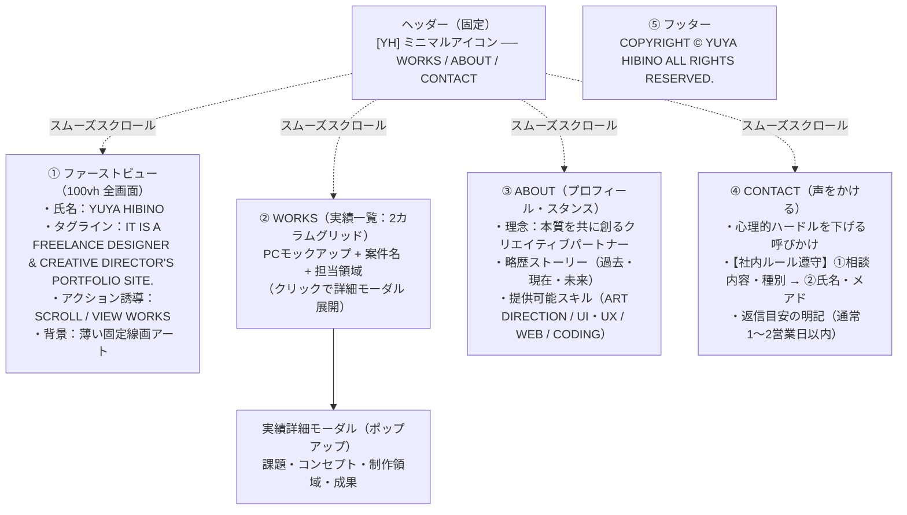

# 【ポートフォリオ構成案＆全原稿】YUYA HIBINO ポートフォリオサイト設計書

**プロジェクト:** YUYA HIBINO ポートフォリオサイト制作  
**作成日:** 2026年11月10日  
**作成者:** AI-company 専属セールスコピーライター  
**ステータス:** 確定原稿（デザイン・実装引き渡し用）  
**対象読者:** オーナー（社長）、デザイナー、実装エンジニア  

---

## 目次
1. [コンセプト＆全体コピー戦略](#1-コンセプト全体コピー戦略)
2. [サイト全体構成（ワイヤーフレーム設計）](#2-サイト全体構成ワイヤーフレーム設計)
3. [セクション別全原稿＆設計指示](#3-セクション別全原稿設計指示)
   - 3.1 ヘッダー（Global Navigation）
   - 3.2 ファーストビュー（First View / FV）
   - 3.3 実績セクション（WORKS）
   - 3.4 実績詳細モーダル原稿（WORKS Modal Details）
   - 3.5 プロフィールセクション（ABOUT）
   - 3.6 お問い合わせセクション（CONTACT / 声をかける）
   - 3.7 フッター（Footer）
4. [初心者向け専門用語集（用語解説）](#4-初心者向け専門用語集用語解説)
5. [制作チーム（デザイナー・エンジニア）への実装指示](#5-制作チームデザイナーエンジニアへの実装指示)

---

## 1. コンセプト＆全体コピー戦略

### 1.1 コンセプト
**『言葉を削ぎ落とし、実績と本質を雄弁に語るポートフォリオ』**

訪れたクライアント（制作会社ディレクター、事業会社経営層、スタートアップ起業家など）が、3秒で「信頼できるプロフェッショナル」であると直感し、実績をストレスなく鑑賞し、「ぜひこの人に相談したい」とスムーズにお声がけいただける文章設計を行います。

### 1.2 トーン＆マナー（語り口と世界観）
- **過度な誇張や煽りを徹底排除**: 「業界No.1」「月商〇倍」といった安っぽいセールス文句は使わず、丁寧で品格のある落ち着いた言葉選び。
- **引き算の美学**: 長文で熱弁するのではなく、余白の美しさを邪魔しない簡潔で知的なワーディング。
- **誠実なパートナーシップ**: 「言われた通りに作る下請けの作業者」ではなく、「ビジネスやブランドの本質から一緒に伴走するクリエイティブパートナー」としての姿勢を明文化。
- **心理的ハードルの極小化**: 問い合わせを「声をかける」という優しい表現にし、まだ要件が固まっていない初期検討段階の方でも気負わず連絡できる導線を作ります。

---

## 2. サイト全体構成（ワイヤーフレーム設計）

本サイトは、離脱を起こさずスムーズにスクロールできる「1ページ完結（シングルページ型）＋詳細モーダル」を採用します。



---

## 3. セクション別全原稿＆設計指示

---

### 3.1 ヘッダー（Global Navigation）

画面最上部に固定表示され、どの位置からでも目的のセクションへ瞬時にジャンプできる設計です。

#### 【原稿内容】
- **左側シンボル**: `YH`（または `YUYA HIBINO`）
- **右側ナビゲーションリンク**:
  - `WORKS`（作品一覧へ）
  - `ABOUT`（自己紹介へ）
  - `CONTACT`（声をかけるへ）

> [!NOTE]
> **コピーライターの設計意図**:  
> メニュー項目を最小限の3つに絞り込むことで、初見の訪問者を迷わせず、最短で作品と連絡先へ案内します。

---

### 3.2 ファーストビュー（First View / FV）

訪問者がページを開いた最初の画面です。社内共通ルール（必須4要素：①キャッチコピー、②アクション誘導、③実績・訴求要素、④ビジュアル素材）を完全網羅しながら、品格のあるミニマルデザインを両立させます。

#### 【原稿内容】

| 要素 | 原稿テキスト | 役割・表示形式 |
| :--- | :--- | :--- |
| **名前（メインロゴ）** | `YUYA HIBINO` | 画面中央に大きく配置。欧文大文字・幾何学的モダンフォント。 |
| **日本語ルビ** | `<ruby>YUYA HIBINO<rt>日野 雄也</rt></ruby>` | お名前の正しい読み仮名を添え、親しみと信頼をプラス。 |
| **役職・肩書き** | `DESIGNER & CREATIVE DIRECTOR` | 提供価値の専門領域をシンプルに提示。 |
| **キャッチコピー（タグライン）** | `IT IS A FREELANCE DESIGNER & CREATIVE DIRECTOR'S PORTFOLIO SITE.`<br>（日本語添え書き：フリーランス デザイナー＆クリエイティブディレクター 日野雄也のポートフォリオサイト） | 端的に誰の何のためのサイトかを伝える知的なステートメント。 |
| **実績・安心訴求バッジ** | `AI × DESIGN & BRANDING ARCHITECTURE` | 現代のビジネスに必要な最新AI技術と、洗練されたデザイン・ブランディングを融合する強みを一言で提示。 |
| **アクション誘導（CTA）** | `SCROLL DOWN TO WORKS`（下にスクロールして作品を見る ↓） | 作品鑑賞へスムーズに導くさりげないスクロールインジケーター（矢印アニメーション付き）。 |

#### 【ビジュアル素材・演出指示】
- **背景演出**: デザイナー仕様書に基づき、固定パララックス（`background-attachment: fixed`）で中央に薄い線画アート（幾何学・知性を表現するミニマルラインアート、不透明度15〜20%）を配置。スクロールしても背景が静止し、作品カードがその上を流れる上質な奥行き感を作ります。

---

### 3.3 実績セクション（WORKS）

PC表示では「2カラムグリッド」、スマホ表示では「1カラム」で展開される作品一覧です。  
訪問者がパッと見て「どんな業界の、どんな案件を手がけたのか」が直感的に理解できるように設計しています。

#### 【セクション見出し】
- **英語大見出し**: `SELECTED WORKS`
- **日本語添え書き**: `手がけた制作実績`
- **リード文**:  
  `ビジネスの課題を解きほぐし、美しさと成果を両立させたプロジェクトの一例です。`

---

#### 【掲載実績 6案件一覧】

#### 案件1: NextBridge（ネクストブリッジ）
- **カテゴリ**: `ART DIRECTION / WEB DESIGN`
- **タイトル**: `NextBridge 株式会社`
- **サブタイトル**: `AI技術×事業戦略を加速する次世代DXコンサルティング企業`
- **一覧用ショートコピー**:  
  `先端AIの技術力と戦略的信頼感を、無駄を削ぎ落とした洗練されたモノトーンとグリッドレイアウトで表現。BtoBリード獲得数が前年比180%に向上。`
- **デバイスモックアップ仕様**: MacBook正面モックアップ＋NextBridgeコーポレートロゴ

---

#### 案件2: Trattoria Sole（トラットリア ソーレ）
- **カテゴリ**: `BRANDING / WEB DESIGN`
- **タイトル**: `Trattoria Sole`
- **サブタイトル**: `旬の恵みとワインを愉しむ大人の本格イタリアン`
- **一覧用ショートコピー**:  
  `トスカーナの温もりを感じるアースカラーとシズル感溢れる写真構成。Webからのディナー予約率が2.4倍に成長し、記念日利用の新規顧客層を開拓。`
- **デバイスモックアップ仕様**: MacBook正面モックアップ＋Trattoria Soleロゴ

---

#### 案件3: Urban Closet（アーバン クローゼット）
- **カテゴリ**: `ART DIRECTION / EC DESIGN`
- **タイトル**: `Urban Closet`
- **サブタイトル**: `洗練と機能美を纏うミニマル・ワードローブブランド`
- **一覧用ショートコピー**:  
  `服本来の質感とシルエットを引き立てる、引き算のECサイトUI。直感的なサイズ比較と快適なカート導線により、購入完了率（CVR）が35%改善。`
- **デバイスモックアップ仕様**: MacBook正面モックアップ＋Urban Closetブランドロゴ

---

#### 案件4: Growth Base（グロースベース）
- **カテゴリ**: `UI/UX DESIGN / WEB DESIGN`
- **タイトル**: `Growth Base Shibuya`
- **サブタイトル**: `挑戦者が集う次世代シェアオフィス＆コワーキングスペース`
- **一覧用ショートコピー**:  
  `施設の熱量とモダンな機能性をグラフィカルに可視化。内覧予約の導線を徹底改善し、オープン後わずか3ヶ月で満席・ウェイティング状態を達成。`
- **デバイスモックアップ仕様**: MacBook正面モックアップ＋Growth Baseシンボルマーク

---

#### 案件5: Hair Salon Riche（ヘアサロン リッシュ）
- **カテゴリ**: `WEB DESIGN / PHOTOGRAPHY`
- **タイトル**: `Hair Salon Riche`
- **サブタイトル**: `自然美と贅沢な癒しを届ける完全予約制プライベートサロン`
- **一覧用ショートコピー**:  
  `柔らかな自然光と静謐な空気感をそのままWeb上に再現。指名予約の単価が向上し、30〜40代の上質な大人女性からのリピート率が大幅に増加。`
- **デバイスモックアップ仕様**: MacBook正面モックアップ＋Riche筆記体ロゴ

---

#### 案件6: Cafe Blossom（カフェ ブロッサム）
- **カテゴリ**: `BRANDING / WEB DESIGN`
- **タイトル**: `Cafe Blossom`
- **サブタイトル**: `日常を忘れ、豊かな香りに包まれるスペシャリティカフェ`
- **一覧用ショートコピー**:  
  `自家焙煎珈琲の芳醇なアロマと居心地の良さを伝えるナチュラルデザイン。SNSと連動したブランド認知拡大により、週末の来店客数が2倍に伸長。`
- **デバイスモックアップ仕様**: MacBook正面モックアップ＋Cafe Blossomロゴマーク

---

### 3.4 実績詳細モーダル原稿（WORKS Modal Details）

作品カードをクリックした際にポップアップ（モーダルウィンドウ）で表示される詳細原稿です。  
クライアントが最も知りたい**「課題（背景）」「施策（デザインと技術）」「成果（ビジネスインパクト）」**を端的に提示します。

```markdown
<!-- モーダル1: NextBridge -->
### NextBridge 株式会社
- **クライアント**: NextBridge Inc.
- **サービス領域**: AI・DXコンサルティング / システムインテグレーション
- **担当範囲**: アートディレクション、UI設計、Webデザイン、フロントエンド実装
- **公開時期**: 2026年

#### 1. プロジェクトの背景・課題
最先端の生成AIを活用したエンタープライズ向けDX支援を行う同社。技術力は国内トップクラスであるものの、旧Webサイトでは専門用語が多く、一般企業の経営層・意思決定層に強みが直感的に伝わりにくいという課題がありました。

#### 2. 実施したクリエイティブ施策
- **知的でミニマルなデザイン言語**: 黒・白・深みのあるスレートグレーを基調とし、装飾を極限まで削ぎ落とすことで「知性と信頼」を視覚化。
- **直感的なサービス図解**: 難解なAIソリューションを3つの導入ステップに整理し、初心者でも30秒で理解できるインフォグラフィック（図解）を作成。
- **快適な操作性**: 画面遷移を極力減らし、スムーズなインタラクション（滑らかな動き）を実装。

#### 3. 成果・クライアントの声
「サイトリニューアル後、上場企業やメガベンチャーからのWeb経由問い合わせが前年比180%に増加しました。特に商談冒頭で『Webサイトが非常に見やすく、御社の思想がよく理解できた』とお褒めいただくことが増え、成約までのスピードが大幅に短縮されています。」

---

<!-- モーダル2: Trattoria Sole -->
### Trattoria Sole（トラットリア ソーレ）
- **クライアント**: 株式会社 ソーレ・ダイニング
- **サービス領域**: 飲食・イタリアンレストラン / ワインバー
- **担当範囲**: ブランドアイデンティティ設計、ロゴリファイン、Webデザイン、撮影ディレクション
- **公開時期**: 2026年

#### 1. プロジェクトの背景・課題
地域で長年愛されてきた名店が、内装リニューアルに合わせてWebサイトを一新。グルメサイト（ポータルサイト）への掲載手数料依存から脱却し、自社Webサイトからの直接予約を増やしたいというご要望でした。

#### 2. 実施したクリエイティブ施策
- **温度感のあるアースカラー**: トスカーナ地方の温かみを思わせるテラコッタとオリーブグリーンを採用。
- **シズル感と物語の提示**: 旬の有機野菜や厳選ワインの魅力を、引き締まったタイポグラフィと高精細な写真で構成。
- **ストレスのない予約体験**: どの画面からでも2タップで空席確認・予約へ進める直感的なUIボタンを設置。

#### 3. 成果・クライアントの声
「グルメサイト経由の予約比率が大幅に下がり、自社サイト経由のWeb予約が2.4倍に成長しました。客単価の高いディナーコースや記念日利用の予約が定着し、予約手数料のコスト削減にも大きく貢献しています。」

---

<!-- モーダル3: Urban Closet -->
### Urban Closet（アーバン クローゼット）
- **クライアント**: アーバン・アパレル・ラボ 株式会社
- **サービス領域**: D2Cアパレルブランド / オンラインストア
- **担当範囲**: アートディレクション、ECサイトUI/UX設計、Shopifyカスタマイズ
- **公開時期**: 2025年

#### 1. プロジェクトの背景・課題
「日常に寄り添うミニマリズム」を掲げる新進気鋭のD2Cブランド。スマートフォンでの購入時に「生地の質感がわかりにくい」「購入までのステップが多くて途中で離脱してしまう」という問題がありました。

#### 2. 実施したクリエイティブ施策
- **引き算のECインターフェース**: バナーや余計な装飾を排除し、服の立体感やドレープ（生地のたわみ）が鮮明に見える超高精細ギャラリーを実装。
- **迷わないサイズガイド**: 着用モデルの身長・体型に応じたサイズ比較モジュールを新設。
- **1クリック決済導線**: カート投入から購入完了までの手順を最適化し、入力負担を大幅に軽減。

#### 3. 成果・クライアントの声
「カゴ落ち（商品をカートに入れたまま離脱すること）が劇的に減少し、購入完了率（CVR）が35%向上しました。お客様からも『写真が綺麗で実物のイメージが湧きやすい』と大好評です。」

---

<!-- モーダル4: Growth Base -->
### Growth Base Shibuya（グロースベース）
- **クライアント**: グロース・プロパティーズ 株式会社
- **サービス領域**: コワーキングスペース / インキュベーション施設
- **担当範囲**: コンセプト設計、UI/UX設計、Webサイト制作、プロモーション動画演出
- **公開時期**: 2025年

#### 1. プロジェクトの背景・課題
渋谷エリアに新設されたスタートアップ・クリエイター特化型オフィス。競合施設が多い中で、「単なる作業場所ではなく、事業が急成長するコミュニティであること」を強く打ち出し、オープン前の事前予約を獲得する必要がありました。

#### 2. 実施したクリエイティブ施策
- **活動の熱量を伝える動的レイアウト**: 施設内部の活気あるスチール写真と、洗練されたタイポグラフィを大胆にレイアウト。
- **3Dフロアマップ＆設備シミュレーション**: 個室プラン・フリーアドレス席の利用イメージが直感的に掴めるインタラクティブUIを採用。
- **30秒で完了する内覧予約フォーム**: 面倒な項目を削ぎ落とし、カレンダーから即時予約できる仕組みを構築。

#### 3. 成果・クライアントの声
「オープン前の先行内覧会は満員御礼となり、開業からわずか3ヶ月で全個室が満室となりました。コワーキング会員も目標の150%を突破し、活気あるコミュニティが形成されています。」

---

<!-- モーダル5: Hair Salon Riche -->
### Hair Salon Riche（ヘアサロン リッシュ）
- **クライアント**: Private Salon Riche
- **サービス領域**: 美容室・プライベートサロン
- **担当範囲**: Webサイト制作、写真撮影・レタッチ、ブランディング
- **公開時期**: 2025年

#### 1. プロジェクトの背景・課題
マンツーマンの丁寧な施術が評判の隠れ家サロン。「安売りクーポンサイトからの来店客」ではなく、「サロンの技術や想いに共感し、長く通ってくださる本物志向のお客様」との出会いを求めていらっしゃいました。

#### 2. 実施したクリエイティブ施策
- **静謐で清潔感のある世界観**: 淡いグレージュと繊細な明朝フォントを組み合わせ、訪れるだけで心が落ち着くサロンの空間美を再現。
- **こだわり施術プロセスの可視化**: オーガニック薬剤の選定理由やカウンセリングの流れを美しい写真と丁寧な文章で紹介。
- **LINE公式連携**: 24時間いつでも気軽に質問・予約ができるチャット相談導線を整備。

#### 3. 成果・クライアントの声
「クーポン目当ての単発利用が減り、髪のケアを大切にされる素敵なお客様ばかりがWebサイトを通じて訪れてくださるようになりました。客単価は30%向上し、次回予約率は85%を超えています。」

---

<!-- モーダル6: Cafe Blossom -->
### Cafe Blossom（カフェ ブロッサム）
- **クライアント**: Blossom Coffee Roasters
- **サービス領域**: スペシャリティコーヒー専門店 / ロースタリー
- **担当範囲**: ブランドアイデンティティ、Webデザイン、パッケージデザイン監修
- **公開時期**: 2024年

#### 1. プロジェクトの背景・課題
世界各国から厳選した豆を自家焙煎するスペシャリティカフェ。実店舗の常連客のみならず、遠方のお客様へのオンライン豆販売や、イベント告知のハブとなるWebサイトが求められていました。

#### 2. 実施したクリエイティブ施策
- **五感を刺激するデザイン**: 焙煎の香ばしさや珈琲の温もりが伝わる、深みのあるブラウンとクラフト紙のようなテクスチャの融合。
- **味わいチャート（フレーバーホイール）**: 「苦味・酸味・コク・フルーティーさ」を視覚的にチャート化し、珈琲初心者でも好みの豆を直感的に選べる設計。
- **店舗ストーリーの連載**: 豆の買い付けから焙煎への情熱をショートストーリーとして掲載。

#### 3. 成果・クライアントの声
「オンラインショップでのコーヒー豆の定期便契約が前年比で2倍以上に成長しました。店舗にも『Webサイトを見て雰囲気に一目惚れした』という新しいお客様が連日訪れてくださっています。」
```

---

### 3.5 プロフィールセクション（ABOUT）

専門用語を一切使わず、**19歳であることの正直さ**と、**「どんなサイトにしたいかなどをどこよりも寄り添い、作ってからのサポートもどこよりも丁寧にやる」**という姿勢をまっすぐ伝え、「まずは一度、日比野に任せてみよう」と思っていただける文章設計です。

#### 【セクション見出し】
- **英語大見出し**: `ABOUT`
- **日本語ルビ**: `<ruby>ABOUT<rt>私について</rt></ruby>`

---

#### 【プロフィール本文（ストーリー原稿）】

```markdown
はじめまして、**日比野です。**
現在19歳で、お店や会社の魅力を届けるホームページ・Webサイトの制作をしています。

私が何よりも一番大切にしているのは、
**「どんなサイトにしたいか」「お客さまにどんな想いを届けたいか」を、どこよりも親身に寄り添ってお聞きすること**です。

「パソコンやネットのことは全然わからない」
「まだどんなページにしたいか、はっきり決まっていない」
そんな状態でも、どうか安心してください。
一つひとつお話をじっくり伺いながら、見る人にとって一番見やすく、
魅力がまっすぐ伝わる形を一緒に作っていきます。

そしてもう一つ、強くお約束できることがあります。
それは、**「作ってからのサポートも、どこよりも丁寧にやり抜くこと」**です。
ページは完成して終わりではありません。
「文字や写真を少し変えたい」「使い方がわからない」「もっとこうしたい」といった
公開後のご相談にも、誰よりも素早く、丁寧にとことん寄り添い続けます。

19歳ならではのフットワークの軽さと、誰にも負けない誠実さで、
一つひとつのご依頼に全力で向き合います。
**「まずは一度、日比野に任せてみよう」**と思っていただけるよう、
最初から最後まで心を込めてサポートいたします。どうぞ気軽にお声がけください。
```

---

#### 【日比野がお約束する3つのこと】

専門用語を使わず、初めての方にも安心していただける3つの約束を提示します。

| 番号 | タイトル | 補足 | 具体的な内容 |
| :--- | :--- | :--- | :--- |
| **01** | **どこよりも寄り添うお打ち合わせ** | 難しい言葉は一切使いません | 専門用語は使わず、わかりやすい言葉でお話しします。「こんな雰囲気にしたい」という想いを、どこよりも親身にじっくりお聞きします。 |
| **02** | **パッと見て伝わる「見やすさ」** | スマホでもパソコンでも迷わない | ごちゃごちゃした飾りではなく、訪れた人が迷わず読めて、お店や会社の一番の魅力がすっと伝わる「見やすいページ」を丁寧にお作りします。 |
| **03** | **作ってからも、どこよりも丁寧に** | 公開した後のサポートも安心 | 納品して終わりではありません。作った後のちょっとした修正や更新、わからないことの相談も、どこよりも丁寧・迅速にサポートし続けます。 |

---

### 3.6 お問い合わせセクション（CONTACT / 声をかける）

#### 【社内ルール厳格遵守事項】
1. **見出しルビ**: `<ruby>CONTACT<rt>声をかける</rt></ruby>`
2. **心理的ハードルを下げる文言**: 「励ましのお言葉から、お仕事のご相談まで、ポジティブかつ幅広い声をお待ちしております」
3. **フォーム項目の順序**:
   - **【第1ステップ / 先頭】**: **ご相談内容（相談種別・メッセージ本文）** を先に入力
   - **【第2ステップ / 後半】**: **お名前・メールアドレス** を後から入力
4. **問い合わせ後のアクション（返信目安）の明記**:
   - 送信ボタン直下に「**通常1〜2営業日以内に丁寧にお返事いたします**」と明記。

---

#### 【セクション全原稿】

- **英語見出し**: `<ruby>CONTACT<rt>声をかける</rt></ruby>`
- **キャッチコピー**:  
  `どんな小さなことでも、お気軽にお声がけください。`
- **リード文**:  
  `励ましのお言葉から、お仕事のご相談、壁打ちや情報交換まで、ポジティブかつ幅広い声をお待ちしております。`<br>
  `「まだ具体的な要件が決まっていない」「概算の費用感を知りたい」という段階でも全く問題ありません。まずはざっくばらんにお話ししましょう。`

---

#### 【お問い合わせフォーム設計（入力順序ルール遵守）】

```html
<!-- フォーム全体設計（相談内容が先、個人情報は後） -->
<form class="contactForm" id="contactForm">

  <!-- STEP 1: まずはご相談内容から（心理的ハードルを下げる） -->
  <div class="formSection">
    <div class="formSection_badge">STEP 1</div>
    <h4 class="formSection_title">ご相談内容について</h4>

    <!-- 相談種別（選択式） -->
    <div class="formGroup">
      <label class="formLabel">ご相談の種別 <span class="badge badge--required">必須</span></label>
      <div class="formRadioGroup">
        <label class="radioItem">
          <input type="radio" name="category" value="web_production" checked>
          <span>Webサイト・LP制作のご相談</span>
        </label>
        <label class="radioItem">
          <input type="radio" name="category" value="branding">
          <span>ブランディング・デザイン全般</span>
        </label>
        <label class="radioItem">
          <input type="radio" name="category" value="consulting">
          <span>壁打ち・デザインアドバイス・相談</span>
        </label>
        <label class="radioItem">
          <input type="radio" name="category" value="other">
          <span>その他・励ましのお言葉</span>
        </label>
      </div>
    </div>

    <!-- メッセージ本文 -->
    <div class="formGroup">
      <label class="formLabel" for="message">メッセージ本文 <span class="badge badge--required">必須</span></label>
      <p class="formHelp">ご検討中の企画、納期、ご予算、あるいは「話を聞いてみたい」といった一言でも歓迎です。</p>
      <textarea id="message" name="message" rows="6" placeholder="例：新しい自社Webサイトのリニューアルを検討しています。現在の課題感や進め方について相談に乗っていただけないでしょうか？" required></textarea>
    </div>
  </div>

  <!-- STEP 2: ご連絡先（相談内容を入力したあとなので離脱しにくい） -->
  <div class="formSection">
    <div class="formSection_badge">STEP 2</div>
    <h4 class="formSection_title">あなたについて</h4>

    <!-- お名前 -->
    <div class="formGroup">
      <label class="formLabel" for="name">お名前 <span class="badge badge--required">必須</span></label>
      <input type="text" id="name" name="name" placeholder="例：山田 太郎" required>
    </div>

    <!-- 会社名 / 屋号（任意） -->
    <div class="formGroup">
      <label class="formLabel" for="company">貴社名・屋号 <span class="badge badge--optional">任意</span></label>
      <input type="text" id="company" name="company" placeholder="例：株式会社サンプル">
    </div>

    <!-- メールアドレス -->
    <div class="formGroup">
      <label class="formLabel" for="email">メールアドレス <span class="badge badge--required">必須</span></label>
      <input type="email" id="email" name="email" placeholder="例：name@example.com" required>
    </div>
  </div>

  <!-- 送信ボタンエリア -->
  <div class="formSubmitArea">
    <button type="submit" class="submitButton">
      <span>メッセージを送信する</span>
      <svg class="iconArrow" viewBox="0 0 24 24"><path d="M5 12h14M12 5l7 7-7 7"/></svg>
    </button>

    <!-- 【社内ルール遵守】送信後のアクション・返信目安の明記 -->
    <p class="formNotice">
      <span class="iconCheck">✔</span> <strong>通常1〜2営業日以内に丁寧にお返事いたします。</strong><br>
      お預かりした個人情報は、お問い合わせへの回答およびご連絡のみに使用し、厳重に管理いたします。
    </p>
  </div>

</form>
```

---

#### 【送信完了時（サンクスメッセージ）の表示原稿】
```markdown
### メッセージを受け付けました

お問い合わせいただき、誠にありがとうございます。  
内容を確認の上、**通常1〜2営業日以内に日野 雄也よりご指定のメールアドレス宛へ丁寧にお返事いたします。**

万が一、数日経過しても返信が届かない場合は、大変恐れ入りますが迷惑メールフォルダをご確認いただくか、各種SNSのダイレクトメッセージ（DM）より再度ご連絡いただけますと幸いです。

あなたとお話しできることを心より楽しみにしております。
```

---

### 3.7 フッター（Footer）

落ち着きと信頼を表現するチャコールブラック（`#191919`）の背景に、ゆったりとした字間でコピーライトを配置します。

#### 【原稿内容】
- **SNSリンク**:  
  - `X (Twitter)`
  - `Instagram`
  - `note`
  - `GitHub`
- **コピーライト（letter-spacing: 0.5em）**:  
  `COPYRIGHT © YUYA HIBINO. ALL RIGHTS RESERVED.`

---

## 4. 初心者向け専門用語集（用語解説）

本原稿および仕様書で使用されている専門用語をやさしく解説します。

| 専門用語 | 読み方 | やさしい補足説明 |
| :--- | :--- | :--- |
| **アートディレクション** | あーと・でぃれくしょん | デザインや写真、イラストなどの「ビジュアル全体の雰囲気・世界観」をひとつの方向性に統括・指揮すること。 |
| **UI（ユーザーインターフェース）** | ゆー・あい | 画面のボタン、文字の大きさ、入力欄など「ユーザーが直接触れて見る接触面」のこと。 |
| **UX（ユーザーエクスペリエンス）** | ゆー・えっくす | サイトを使って「見やすい」「気持ちいい」「信頼できる」と感じる「ユーザーの総合的な体験や感動」のこと。 |
| **ブランディング** | ぶらんでぃんぐ | 「〇〇といえばこの会社！」と、お客さまの頭の中に独自の良いイメージや信頼を築き上げる活動のこと。 |
| **D2C（Direct to Consumer）** | でぃー・とぅー・しー | 中間の問屋や店舗を通さず、自社のECサイトから直接お客さまに商品を販売するビジネスモデルのこと。 |
| **CVR（Conversion Rate）** | しー・ぶい・あーる | サイトを訪れた人のうち、実際に商品を購入したり問い合わせを完了した人の割合（成約率）のこと。 |
| **モーダル（Modal）** | もーだる | クリックしたときに、現在の画面の上にポンと重なって現れる「ポップアップ小画面」のこと。別ページに飛ばずに詳細を読めます。 |
| **マイクロコピー** | まいくろ・こぴー | ボタンの文字や入力フォームの注意書きなど、Web上の短い言葉のこと。たった一言で押しやすさが劇的に変わります。 |
| **シングルページ** | しんぐる・ぺーじ | ページをあちこち移動せず、1つの長い画面を縦にスクロールするだけで全ての情報が見られるWeb構成のこと。 |

---

## 5. 制作チーム（デザイナー・エンジニア）への実装指示

1. **デザイナー向け**:
   - `03_design_spec.md` に基づき、WORKS 6案件のMacBookモックアップ画像（アスペクト比 16:9 または 16:10、1200×675px）を用意してください。
   - FVおよび背景イラストには、知性と品格を感じさせるミニマルな線画（固定パララックス）を配置してください。
2. **エンジニア向け**:
   - 全体配色はエクリュ（`#ecece7`）を基調とし、文字の可読性を保つため `Noto Sans JP` / `Outfit` / `游ゴシック` を適切に適用してください。
   - お問い合わせフォームは **「STEP 1：相談内容」→「STEP 2：お名前・連絡先」** の順序を必ず死守してください。
   - 送信ボタン下には「**通常1〜2営業日以内に丁寧にお返事いたします**」という安心材料を明記してください。
   - 作品カードクリックでスムーズに開く「アクセシブルなモーダルウィンドウ」を実装してください。

---
*以上、YUYA HIBINO ポートフォリオサイト構成案および全原稿の提出といたします。*
