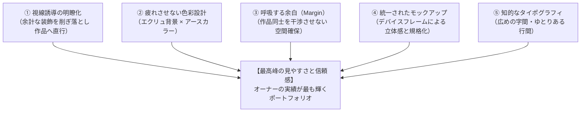
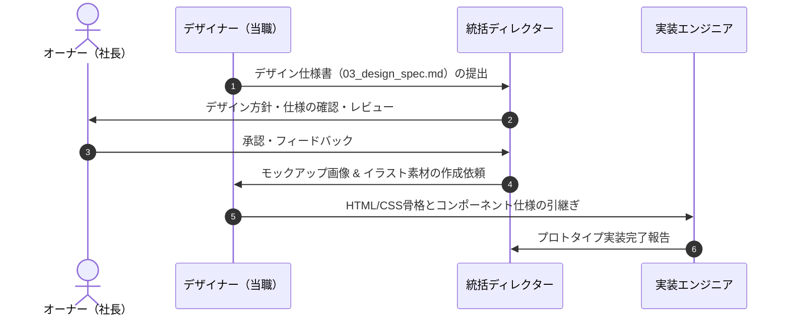

# ポートフォリオサイト ビジュアルデザイン研究・分析レポート & 見やすさ重視のデザイン仕様書

**プロジェクト:** オーナー（社長）ポートフォリオ制作プロジェクト  
**作成日:** 2026年11月10日  
**作成者:** AI-company 専属UI/UX・Webデザイナー  
**ステータス:** 確定仕様（プロトタイプ設計用）

---

## 目次
1. [エグゼクティブ・サマリー（はじめに）](#1-エグゼクティブサマリーはじめに)
2. [参考サイト徹底研究・分析（デザインの秘訣）](#2-参考サイト徹底研究分析デザインの秘訣)
   - 2.1 配色設計：目に優しく上質なアースカラー＆ナチュラル設計
   - 2.2 タイポグラフィ：文字詰め・letter-spacing・vw指定の美学
   - 2.3 余白とレイアウト：作品を引き立てる「美術館のような空間設計」
   - 2.4 背景イラスト演出：固定配置（fixed）による立体感と親しみやすさ
   - 2.5 実績の見せ方：ノートPCモックアップがもたらすリアリティと信頼
3. [「見やすさ重視」を実現するためのデザイン原則（Design Rules）](#3-見やすさ重視を実現するためのデザイン原則design-rules)
4. [オーナーポートフォリオへの適用デザイン仕様書（Design Specification）](#4-オーナーポートフォリオへの適用デザイン仕様書design-specification)
   - 4.1 デザインコンセプト＆トーン＆マナー
   - 4.2 カラーパレット設計（カラーコード一覧）
   - 4.3 タイポグラフィ設計（フォント選定・サイズ・字間・行間）
   - 4.4 レイアウト＆グリッド仕様（2カラムシステム）
   - 4.5 作品アイキャッチ（PCモックアップ）作成ガイドライン
   - 4.6 背景イラスト・固定パララックス演出の設計
   - 4.7 レスポンシブ対応基準（PC / SP）
5. [専門用語解説（初心者向け用語集）](#5-専門用語解説初心者向け用語集)
6. [ディレクター・エンジニアへの共有事項と次のアクション](#6-ディレクターエンジニアへの共有事項と次のアクション)

---

## 1. エグゼクティブ・サマリー（はじめに）

社長、ご依頼ありがとうございます！  
本レポートは、ご提示いただいた参考サイト（佐藤タカアキ氏のポートフォリオ：`https://sato-takaaki.work/`）および添付画像・ソースコードを、プロのUI/UX・Webデザイナーの視点から隅々まで解剖・分析し、**「なぜこのサイトはこれほど見やすく、洗練されて感じられるのか」** というビジュアルデザインの秘密を解き明かしたものです。

さらに、そのエッセンスを当社のオーナー（社長）向けポートフォリオにどう落とし込み、**「見やすさ重視」×「圧倒的な信頼感」** を両立させるかの具体的なデザイン仕様としてまとめました。

Webデザインに詳しくない方でも直感的に理解できるよう、専門用語にはすべて丁寧な補足解説を添えています。ぜひ安心してお読みください。

---

## 2. 参考サイト徹底研究・分析（デザインの秘訣）

### 2.1 配色設計：目に優しく上質なアースカラー＆ナチュラル設計

参考サイトのカラー設計は、Web制作でありがちな「真っ白（`#ffffff`）に黒文字」という無機質な構成とは一線を画しています。

| 役割 | カラーコード | 色の名称 | デザイン上の意図・効果 |
| :--- | :--- | :--- | :--- |
| **ベース背景色** | `#ecece7` | サンドグレー / エクリュ（生成り） | ディスプレイの強い発光感を和らげ、まるで「上質な画用紙や美術館の壁」のような落ち着きと温かみを生む。長時間の閲覧でも目が疲れません。 |
| **ブランド・アクセント** | `#a28d69` | ゴールドオーカー / サンドベージュ | 黄土色や真鍮（ブラス）のような上品なアースカラー。原色の派手さを排し、洗練された知性と職人気質（クラフトマンシップ）を伝えます。 |
| **テキスト・引き締め** | `#000000` / `#191919` | チャコールブラック / 漆黒 | タイトルやカテゴリ、フッター背景に配置。淡い背景との明度差（コントラスト）を明確にし、文字の可読性（読みやすさ）を担保します。 |
| **境界線・ディバイダー** | `#1f1f1f` / `#9c9c9b` | ニュートラルグレー | 1pxの極細ラインで配置され、情報の区切りを邪魔することなく整頓します。 |

> [!NOTE]
> **デザイナーの視点：なぜ真っ白（#ffffff）ではないのか？**  
> パソコンやスマートフォンの画面は自ら発光しています。背景が完全な真っ白だと、光が強すぎて目がチカチカする「グレア（眩惑）」現象が起きます。  
> わずかに黄みやグレーを含んだ `#ecece7` を敷くことで、画面全体が柔らかなトーンに包まれ、作品画像の中にある「白」がパッと際立って見えるコントラスト効果を生み出しています。

---

### 2.2 タイポグラフィ：文字詰め・letter-spacing・vw指定の美学

文字（タイポグラフィ）の扱いこそが、このサイトの「品の良さ」を決定づけている最大の要因です。

#### (1) フォントの選定と役割分担
- **欧文ロゴ・メインビジュアル**: `Reitam Regular`  
  幾何学的（ジオメトリック）で無駄のない直線と曲線を持つモダンなサンセリフ。洗練された現代的なクリエイターの雰囲気を放ちます。
- **ナビゲーション・フッターコピー**: `PT Sans Narrow`  
  文字幅がスリムな「長体（コンデンスフォント）」です。横幅を抑えつつ縦のリズムを作るため、余白の多い画面でも文字が間延びせず、引き締まった印象を与えます。
- **見出し・作品タイトル**: `Noto Sans` (SemiBold / Medium)  
  GoogleとAdobeが共同開発した、視認性・可読性に極めて優れた現代のスタンダードフォント。太さのメリハリが効いています。
- **長文・本文（ABOUT等）**: `游ゴシック体 (Yu Gothic)`  
  文字のふところが狭く、日本語の長文を組んだ際に最も知的で美しい余白感を生み出すフォントです。

#### (2) letter-spacing（文字と文字の間隔）の広大な設計
- メインロゴ: `letter-spacing: .2em;`
- ヘッダーナビ: `letter-spacing: .1em;`
- フッターのコピーライト: **`letter-spacing: .5em;`**（文字の幅の半分以上の隙間を空けている）
- 本文: `letter-spacing: .075em;` / `line-height: 2.2em;`（行間が文字高の2.2倍）

> [!TIP]
> **初心者のための補足解説：なぜ字間と行間を広げるのか？**  
> 文字同士が詰まっていると、新聞やチラシのように「情報がギッシリ詰まった急ぎ足の印象」になります。  
> 逆に字間（letter-spacing）を広げ、行間（line-height）を2倍以上にゆったり取ると、高級ブランドや美術館のキャプションのような「贅沢なゆとり」が生まれ、一文字ずつ噛みしめるように落ち着いて読むことができます。

#### (3) 単位としての `vw`（Viewport Width）の徹底活用
ソースコードを分析すると、フォントサイズや余白に `px` ではなく `vw`（画面横幅に対するパーセンテージ）が徹底して使われています。
- タイトル: `font-size: 1.3vw;`
- カテゴリ: `font-size: 1vw;`
- これにより、どんな大きさのディスプレイ（MacBookでも大型外部モニターでも）で見ても、**「文字と余白の比率が完璧に保たれ、意図した通りの美しいレイアウトが絶対に崩れない」** という精密なレスポンシブ制御が実現されています。

---

### 2.3 余白とレイアウト：作品を引き立てる「美術館のような空間設計」

参考サイトのトップページは、贅沢な「ホワイトスペース（余白）」で構成されています。

```
画面全体幅 (100vw)
┌────────────────────────────────────────────────────────┐
│  左余白 (9.375vw)                                      │
│  ┌──────────────────────────────────────────────────┐  │
│  │ コンテンツ全体幅: 81.25vw                        │  │
│  │                                                  │  │
│  │  ┌───────────────┐     ┌───────────────┐        │  │
│  │  │  作品カード1  │     │  作品カード2  │        │  │
│  │  │   (幅 39vw)   │     │   (幅 39vw)   │        │  │
│  │  └───────────────┘     └───────────────┘        │  │
│  │           間隔 (ガター): 3.25vw                  │  │
│  │                                                  │  │
│  │            下方向の余白: 7.5vw                   │  │
│  │                                                  │  │
│  │  ┌───────────────┐     ┌───────────────┐        │  │
│  │  │  作品カード3  │     │  作品カード4  │        │  │
│  │  │   (幅 39vw)   │     │   (幅 39vw)   │        │  │
│  │  └───────────────┘     └───────────────┘        │  │
│  └──────────────────────────────────────────────────┘  │
│                                      右余白 (9.375vw)  │
└────────────────────────────────────────────────────────┘
```

#### 美しさの数学的黄金比
- **コンテンツ幅**: `81.25vw`（画面全体の約81%）。左右に約19%の「呼吸できる余白」を確保。
- **2カラム構成**: カード1枚あたり `39vw`。2枚で `78vw`。
- **カード間の隙間（ガター）**: `81.25vw - 78vw = 3.25vw`。
- **カード下の縦余白**: `7.5vw`（PC画面で約100px〜140px相当）。

> [!NOTE]
> **「美術館のホワイトキューブ効果」とは？**  
> 美術館の展示室（ホワイトキューブ）では、絵画と絵画の間に数メートルの何もない空間を設けます。隣の絵が視界に入って鑑賞を邪魔しないためです。  
> このサイトも同様に、あえて広大な余白を取ることで、1つの作品が独立して目に入り、「作品本来のクオリティ」を最大限に引き立てる構造になっています。

---

### 2.4 背景イラスト演出：固定配置（fixed）による立体感と親しみやすさ

参考サイトのCSSには、非常にエレガントな演出が施されています。

```css
.wrapper--top {
  background-image: url("/images/bg_illust.png");
  background-attachment: fixed;
  background-position: center;
  background-repeat: no-repeat;
  background-size: 35%;
}
```

#### この演出がもたらす2つの効果
1. **パララックス効果（視差効果）による立体感**:
   - `background-attachment: fixed` により、ページを上下にスクロールしても、背景のイラストは画面中央に静かに留まり続けます。
   - その上を作品カードがスルスルと流れていくため、**「手前を作品が通り過ぎ、奥にイラストが静止している」という心地よい奥行き感（レイヤー構造）** が生まれます。
2. **「親しみやすさ」と「プロ感」の共存**:
   - デザインがミニマル（シンプル）すぎると、時に「冷たい」「気取っている」という印象を与えがちです。
   - ここに手描きの柔らかな線画イラストを薄いトーン（作品の邪魔をしない控えめなコントラスト）で忍ばせることで、オーナーの「温かい人柄」「親しみやすさ」「クリエイティブな遊び心」を自然に伝えています。

---

### 2.5 実績の見せ方：ノートPCモックアップがもたらすリアリティと信頼

添付画像2（WORKS一覧）で最も目を惹くのが、作品画像の作られ方です。

#### なぜ単なるスクリーンショットではダメなのか？
- Webサイトの四角いスクリーンショットをそのまま並べると、平面的で「カタログのサムネイル」のように見えてしまいます。
- 参考サイトでは、すべてのアイキャッチ画像が**「美しいノートPC（MacBook）の画面内にWebサイトが表示されているモックアップ」** に統一されています。

#### モックアップ化による3大メリット
1. **使用イメージの具体化（リアリティ）**:  
   実際にブラウザ上で動いている様子が直感的に想像でき、完成度の高さが伝わります。
2. **ブランドロゴとの調和（パネル構成）**:  
   カード画像の右側（または余白部分）に、クライアントのロゴマークやキーカラーが品良く配置されており、1枚の完成されたグラフィック作品として鑑賞できます。
3. **統一感の維持**:  
   案件ごとにデザインや色味が全く異なるWebサイトであっても、「PCモックアップのフレーム」という共通の枠組みを通すことで、一覧画面全体として完璧な統一感が保たれます。

---

## 3. 「見やすさ重視」を実現するためのデザイン原則（Design Rules）

私たちがオーナーのポートフォリオを制作する上で遵守すべき【5つの黄金ルール】を策定しました。



1. **引き算の美学（Less is More）**:  
   派手なアニメーションや奇抜な装飾は一切入れない。主役は「オーナーが手がけた実績」そのものである。
2. **光のコントロール（Eye Comfort）**:  
   背景は目に優しいエクリュ（`#ecece7`）とし、長時間の閲覧でもストレスを与えない。
3. **呼吸する空間（Breathing Space）**:  
   要素と要素の間には、ためらわずに大きな余白を設ける。余白こそが品質の証明である。
4. **リアリティの担保（Tangible Experience）**:  
   Web実績は必ず統一された高品質なPCモックアップに収め、実際の動作環境を想起させる。
5. **端正な文字組み（Refined Typography）**:  
   欧文はスタイリッシュに、和文は読みやすく。字間・行間に十分なゆとりを持たせる。

---

## 4. オーナーポートフォリオへの適用デザイン仕様書（Design Specification）

### 4.1 デザインコンセプト＆トーン＆マナー

- **コンセプト**:  
  **『AI × Design の静謐な知性と、実績を語る美術館型ポートフォリオ』**
- **キーワード**:  
  洗練（Sophisticated） / 静謐（Serene） / 信頼（Reliability） / 親しみ（Warmth） / 本質（Essence）
- **トーン＆マナー**:  
  過度な自己主張を抑え、清潔で温かみのあるキャンバスの上に、制作実績が鮮やかに浮かび上がる上質空間。

---

### 4.2 カラーパレット設計（カラーコード一覧）

| トークン名 | HEXコード | RGB | 用途 |
| :--- | :--- | :--- | :--- |
| `--color-bg-base` | `#ecece7` | 236, 236, 231 | ページ全体の基本背景色（エクリュ） |
| `--color-bg-card` | `#ffffff` | 255, 255, 255 | モックアップ背景、カード内部のベース |
| `--color-text-primary` | `#191919` | 25, 25, 25 | メインロゴ、大見出し、カテゴリ名（黒） |
| `--color-text-accent` | `#a28d69` | 162, 141, 105 | 作品タイトル、ナビリンク、主要ボタン（真鍮ベージュ） |
| `--color-text-body` | `#333333` | 51, 51, 51 | プロフィール本文、解説テキスト |
| `--color-text-muted` | `#8c8c87` | 140, 140, 135 | 役職表記、補足情報、メタデータ |
| `--color-border` | `#d5d5ce` | 213, 213, 206 | カード区切り線、プロフィール区切り線 |
| `--color-footer-bg` | `#191919` | 25, 25, 25 | フッター背景（重厚感のあるチャコール） |
| `--color-footer-text` | `#e5e5de` | 229, 229, 222 | フッターコピーライト文字 |

---

### 4.3 タイポグラフィ設計（フォント選定・サイズ・字間・行間）

#### (1) 推奨フォントスタック（Web標準・Google Fonts活用）
- **欧文タイトル・ロゴ**: `Outfit` または `Syne`, sans-serif（幾何学的でモダンな美しさ）
- **欧文ナビ・フッター**: `PT Sans Narrow` または `Oswald`, sans-serif（縦長スリムでスタイリッシュ）
- **和文見出し・タイトル**: `Noto Sans JP`, sans-serif（ウェイト: 500 Medium, 700 Bold）
- **和文本文（プロフィール等）**: `游ゴシック体`, `Yu Gothic`, `Noto Sans JP`, sans-serif（ウェイト: 400 Regular）

#### (2) タイポグラフィスケール（PC表示時）

| 要素 | フォント指定 | サイズ目安（vw / px） | 字間（letter-spacing） | 行間（line-height） |
| :--- | :--- | :--- | :--- | :--- |
| **FVロゴ（メイン）** | 欧文（Outfit） | `2.4vw`（約34〜40px） | `0.2em` | 1.2 |
| **FVキャッチコピー** | 欧文（PT Sans Narrow） | `1.1vw`（約16〜18px） | `0.15em` | 1.5 |
| **ヘッダーナビ** | 欧文（PT Sans Narrow） | `1.3vw`（約18〜20px） | `0.1em` | 1.0 |
| **作品タイトル** | 和文（Noto Sans JP M） | `1.3vw`（約18〜20px） | `0.05em` | 1.4 |
| **作品カテゴリ/役割** | 欧文大文字（Outfit） | `0.9vw`（約13〜14px） | `0.08em` | 1.2 |
| **プロフィール大見出し** | 欧文＋和文 | `3.6vw`（約50〜56px） | `0.1em` | 1.2 |
| **プロフィール本文** | 和文（游ゴシック/Noto） | `1.1vw`（約16px） | `0.075em` | `2.2`（広大） |
| **フッターコピー** | 欧文（PT Sans Narrow） | `1.2vw`（約16〜18px） | `0.5em` | 1.0 |

---

### 4.4 レイアウト＆グリッド仕様（2カラムシステム）

```
【PC画面レイアウト基準】（横幅 1024px 〜 1920px 共通）
- 全体ラッパー幅: 100vw
- メインコンテンツ幅: 81.25vw（中央揃え: margin: 0 auto）
- WORKSグリッド:
  - display: flex / flex-wrap: wrap / justify-content: space-between
  - 各作品カード幅: 39vw
  - カード間の横余白（ガター）: 3.25vw
  - カード間の縦余白（下マージン）: 7.5vw
  - カード内テキストのパディング: padding: 1.4vw 0 0 0.8em;
```

```
【SP画面レイアウト基準】（横幅 767px 以下）
- 全体ラッパー幅: 100vw
- メインコンテンツ幅: 90vw（左右余白 各5vw）
- WORKSグリッド:
  - 1カラム配置（縦並び）
  - 各作品カード幅: 100% (90vw)
  - カード間の縦余白: 13vw
  - カード内テキストのパディング: margin-top: 4vw; padding-left: 2.7vw;
```

---

### 4.5 作品アイキャッチ（PCモックアップ）作成ガイドライン

オーナーがこれまで制作された実績（NextBridge, growth-base, trattoria-sole, hair-salon-riche, urban-closet, cafe-blossom 等）を美しく提示するための画像規格です。

```
┌────────────────────────────────────────────────────────┐
│ 作品カード（アスペクト比 16:9 または 16:10）          │
│                                                        │
│   ┌─────────────────────┐                              │
│   │   MacBookモック     │          クライアントロゴ    │
│   │  ┌───────────────┐  │         ┌─────────────────┐  │
│   │  │ Webサイト     │  │         │ NextBridge      │  │
│   │  │ ファースト    │  │         │                 │  │
│   │  │ ビュー画面    │  │         └─────────────────┘  │
│   │  └───────────────┘  │                              │
│   │  └───キーボード──┘  │                              │
│   └─────────────────────┘                              │
│                                                        │
└────────────────────────────────────────────────────────┘
```

1. **モックアップの規格統一**:  
   すべての作品カードで同じ角度（正面水平またはわずかな斜めアングル）のMacBookモックアップを使用する。
2. **背景パネル**:  
   カード全体の背景は白（`#ffffff`）または各ブランドの象徴的なグラデーションを敷き、右側にブランドロゴを配置して視覚的なバランスを取る。
3. **画像解像度**:  
   Retinaディスプレイ対応のため、実寸表示（幅39vw ≒ 約600px）の2倍である `横1200px × 縦675px（または縦750px）` で作成・書き出しを行う。

---

### 4.6 背景イラスト・固定パララックス演出の設計

```css
/* PC表示時の固定背景イラスト */
.wrapper--top {
  background-image: url("../images/bg_owner_art.png");
  background-attachment: fixed;
  background-position: center center;
  background-repeat: no-repeat;
  background-size: 32vw; /* 画面中央に程よい大きさで配置 */
}

/* SP表示時：モバイル端末での負荷軽減と可読性のためfixedを解除 */
@media screen and (max-width: 768px) {
  .wrapper--top {
    background: none;
  }
  .mainVisual_bg {
    position: absolute;
    width: 65vw;
    top: 30vh;
    left: 50%;
    transform: translateX(-50%);
    opacity: 0.15;
    z-index: -1;
  }
}
```

- **イラストのモチーフ案**:  
  - 案A: オーナー（社長）の温かみのある手描きミニマル似顔絵（キャップや眼鏡などの特徴をシンプルに線画化）
  - 案B: AI-companyの象徴となる「知性・ネットワーク・幾何学」をモチーフにした繊細な線画アート
- **透明度と線画のトーン**:  
  - 不透明度は `15%〜20%` 程度に抑え、作品カードの文字や画像を一切邪魔しない「透かし絵」のような佇まいに仕上げます。

---

### 4.7 レスポンシブ対応基準（PC / SP）

- **ブレイクポイント**: `768px`
- **PC表示（769px以上）**:
  - ヘッダー固定（`position: fixed`）
  - 2カラムグリッド（`39vw` × 2）
  - 背景イラストのパララックス固定（`background-attachment: fixed`）
- **SP表示（768px以下）**:
  - ヘッダーはシンプルなハンバーガーまたはコンパクト固定
  - 1カラムグリッド（`90vw`）
  - タップ領域（ボタン・リンク）の最小高さを `48px` 以上確保し、指先での操作性を向上。

---

## 5. 専門用語解説（初心者向け用語集）

社内や制作チームでスムーズに共通言語化できるよう、本レポートで使用した専門用語をわかりやすく解説します。

| 専門用語 | 読み方 | やさしい解説 |
| :--- | :--- | :--- |
| **アースカラー** | あーすからー | 地球の大地（土・砂・岩）や植物など、自然界にある落ち着いた色合いのこと。ベージュ、茶色、カーキなど。目になじみやすく安心感を与えます。 |
| **タイポグラフィ** | たいぽぐらふぃ | 文字の形、大きさ、字の間隔、行の間隔などを美しく整えて、読みやすく、かつ魅力的に見せるデザイン技術のこと。 |
| **letter-spacing** | れらー・すぺーしんぐ | 文字と文字の「横のすき間（字間）」を設定するCSSの命令。広くすると優雅で高級な雰囲気になり、狭くすると力強く引き締まった印象になります。 |
| **line-height** | らいん・はいと | 行と行の「縦のすき間（行間）」を設定するCSSの命令。通常は文字の高さの1.5倍程度ですが、2倍以上に広げると雑誌のようにゆったり読めます。 |
| **vw（Viewport Width）** | ぶい・だぶりゅー | 画面の横幅を「100vw」としたときの割合を表す単位。1vwは画面幅の1%のこと。画面の大きさに合わせて自動で大きさが縮尺されるため、バランスが崩れません。 |
| **パララックス** | ぱららっくす | スクロールしたときに、手前の要素と奥の背景が異なる速度で動く「視差（立体）効果」のこと。画面に映画のような奥行き感が生まれます。 |
| **モックアップ** | もっくあっぷ | パソコンやスマートフォンの外枠（フレーム）の画像に、実際のWeb画面をはめ込んだ「完成見本イメージ」のこと。実物感が一気に増します。 |
| **ホワイトスペース** | ほわいとすぺーす | デザインの中で、文字や画像をあえて配置しない「意図的な余白」のこと。要素を詰め込まず余白を取ることで、本当に見せたいものが劇的に引き立ちます。 |
| **サンセリフ** | さんせりふ | 文字の端に「飾り（ひげ）」のない、すっきりとした書体のこと（日本語でいうゴシック体、英語のArialなど）。現代的でスマートな印象になります。 |

---

## 6. ディレクター・エンジニアへの共有事項と次のアクション

本デザイン仕様書の完成を受け、以下のステップで実装・制作を進めることを提案します。



### 次のアクション
1. **作品アイキャッチ画像の作成（デザイナー）**:  
   当社の実績サイト（NextBridge, growth-base, trattoria-sole, hair-salon-riche, urban-closet, cafe-blossom 等）をMacBookモックアップに落とし込んだ高品質アイキャッチ（1200×675px）を作成する。
2. **背景線画イラストの作成（デザイナー）**:  
   固定配置（fixed）用のオーナー似顔絵線画アート、またはAI-companyブランドモチーフ線画を制作する。
3. **HTML/CSSコンポーネントの実装（エンジニア）**:  
   本仕様書のクラス命名規則・vw設計・固定背景演出に基づき、ポートフォリオのHTML・CSSをコーディングする。

---
*以上、ビジュアルデザイン研究・分析レポートおよびデザイン仕様書の提出といたします。*
